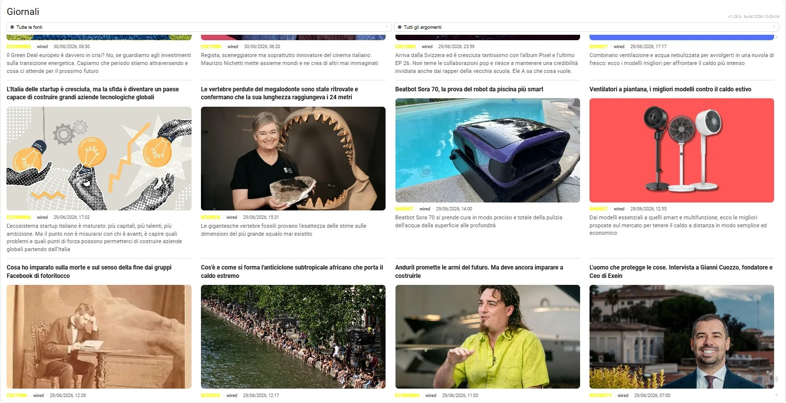
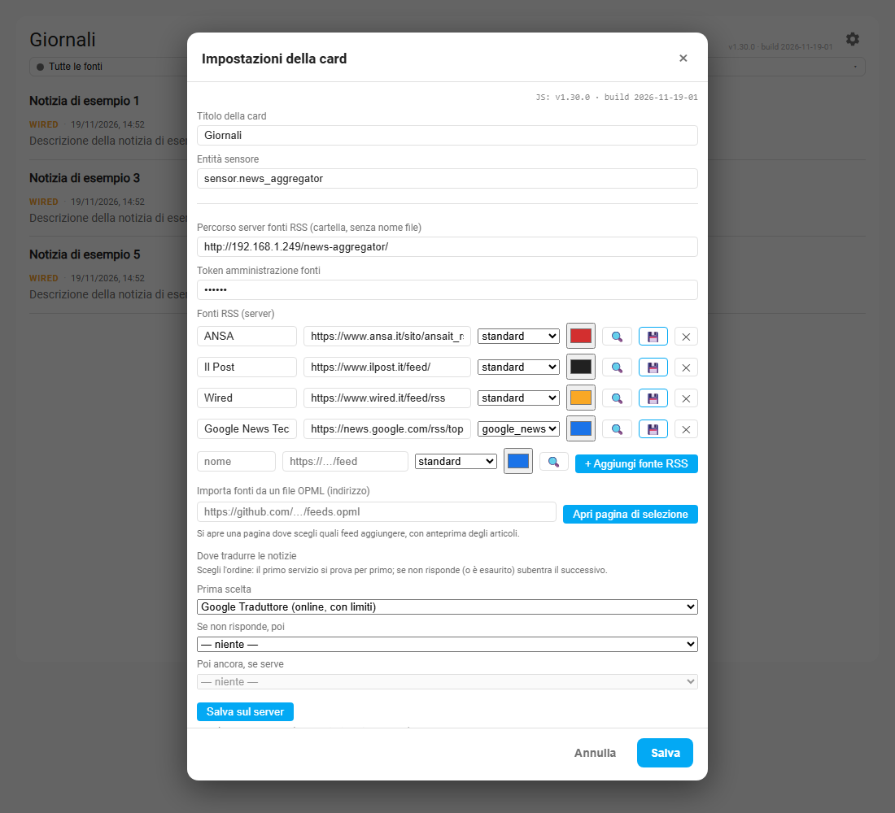

# RSS Paper — card notizie per Home Assistant

Card per le plance di Home Assistant che mostra le notizie di più feed RSS come un giornale: immagini, fonte, argomento, data e descrizione, su più colonne quando c'è spazio.



## Cosa fa

- **Più fonti in una card**: le notizie di tutti i feed in un'unica lista, con un colore per fonte.
- **Filtri** per fonte e per argomento, ricordati anche quando chiudi e riapri l'app.
- **Riassunto automatico**: tocchi una notizia e si apre un popup con le frasi principali dell'articolo, il luogo di cui parla e, se vuoi, i tempi di ogni fase. Da lì puoi aprire l'articolo completo.
- **Traduttore**: le notizie in lingua straniera arrivano tradotte in italiano (titolo e descrizione, con il testo originale sotto in corsivo), e lo stesso vale per i riassunti. Scegli tu l'ordine dei servizi: Google Traduttore, Ollama (sul tuo server) o un traduttore locale tipo LibreTranslate. Se il primo non risponde, si passa al successivo.
- **Impostazioni dall'ingranaggio** ⚙️: si aprono direttamente dalla card, senza mettere la plancia in modifica (vedi sotto).
- **Gestione fonti** dalla card: aggiungi, modifica, verifica o elimina i feed, oppure importali da un file OPML.
- **Blocca notizie**: tieni premuta una notizia per nascondere tutte quelle che vengono dallo stesso percorso del sito.
- **Larghezza e altezza automatiche**: la card può occupare tutta la pagina e riempire lo spazio in verticale.

## Cosa serve

La card mostra le notizie, ma a raccoglierle è un **server con PHP** (il "news-aggregator"). Il server legge i feed, prepara i riassunti e le traduzioni e gestisce l'elenco delle fonti. Il codice è nella cartella [`server/`](server/), con le istruzioni per installarlo: **[server/README.md](server/README.md)**.

In Home Assistant serve un sensore `command_line` che legge le notizie dal server. Le notizie stanno nell'attributo `articles` e il nome predefinito del sensore è `sensor.news_aggregator`. L'esempio è in [server/README.md](server/README.md#sensore-in-home-assistant). Se il sensore manca o è vuoto, la card mostra un riquadro che spiega cosa non va.

## Installazione con HACS

1. In Home Assistant apri **HACS** → ⋮ in alto a destra → **Repository personalizzati**.
2. Incolla `https://github.com/LabirintoDigitale/RSS-homepaper`, scegli il tipo **Dashboard** (o **Plancia**) e premi **Aggiungi**.
3. Cerca **RSS Paper** in HACS, aprila e premi **Scarica**.
4. Ricarica la pagina con **Ctrl+F5**. Sull'app del telefono, svuota la cache dalle impostazioni dell'app.

HACS registra da solo la risorsa `/hacsfiles/RSS-homepaper/rss-news-paper.js`. Se la card dice "Custom element doesn't exist", controlla in **Impostazioni → Plance → ⋮ → Risorse** che ci sia, come **Modulo JavaScript**.

### Aggiornare

In HACS apri **RSS Paper** → **Aggiorna** (o ⋮ → **Aggiorna informazioni** se l'aggiornamento non compare ancora), poi **Ctrl+F5**. La versione caricata è scritta in piccolo in alto a destra nella card.

### Installazione manuale

Copia `rss-news-paper.js` in `config/www/` e aggiungi la risorsa `/local/rss-news-paper.js` come **Modulo JavaScript** in **Impostazioni → Plance → ⋮ → Risorse**.

## Aggiungere la card

In una plancia: **Modifica** → **Aggiungi scheda** → cerca **RSS News Card**. Oppure in YAML:

```yaml
type: custom:rss-news-card
title: Giornali
entity: sensor.news_aggregator
feed_admin_url: http://192.168.1.249/news-aggregator/
feed_admin_token: il-tuo-token
```

## Impostazioni

Gli amministratori vedono un **ingranaggio ⚙️** in alto a destra nella card. Lo premi e si apre lo stesso editor della modifica plancia: cambi quello che ti serve e premi **Salva**. La plancia viene salvata e la card si aggiorna subito, senza entrare in modalità modifica.



Dall'editor puoi anche gestire le fonti RSS sul server, importare un file OPML e scegliere l'ordine dei traduttori.

L'ingranaggio funziona con le plance modificabili dall'interfaccia. Con una plancia in YAML le modifiche vanno fatte nel file della plancia.

### Opzioni

| Opzione | Predefinito | Cosa fa |
|---|---|---|
| `title` | — | Titolo in alto nella card |
| `entity` | `sensor.news_aggregator` | Sensore con l'attributo `articles` |
| `card_height` | `400` | Altezza della lista in px |
| `auto_height` | `false` | Riempie lo spazio fino al fondo della pagina (ignora `card_height`) |
| `full_width` | `true` | La card usa tutta la larghezza della pagina |
| `max_width` | `0` | Larghezza massima in px (`0` = nessun limite) |
| `column_min_width` | `380` | Larghezza minima di una colonna di notizie in px |
| `show_description` | `true` | Mostra la descrizione |
| `show_source` | `true` | Mostra la fonte |
| `show_date` | `true` | Mostra la data |
| `show_original` | `true` | Sotto titolo e descrizione tradotti mostra il testo originale |
| `summary_popup` | `true` | Al tocco apre il riassunto invece dell'articolo |
| `summary_location` | `true` | Nel riassunto mostra il luogo di cui parla la notizia |
| `summary_stats` | `true` | Nel riassunto mostra le fasi e i tempi |
| `title_font_size` | `15` | Dimensione titolo notizia (px) |
| `desc_font_size` | `14` | Dimensione descrizione (px) |
| `card_title_color` | — | Colore del titolo della card |
| `article_title_color` | — | Colore dei titoli delle notizie |
| `desc_color` | — | Colore delle descrizioni |
| `feed_admin_url` | `http://192.168.1.249/news-aggregator/` | Cartella del server news-aggregator (senza nome file) |
| `feed_admin_token` | — | Token per gestire fonti e traduzione sul server |
| `layout_debug` | `false` | Scrive nella card i dati sulla larghezza, per capire problemi di layout |
